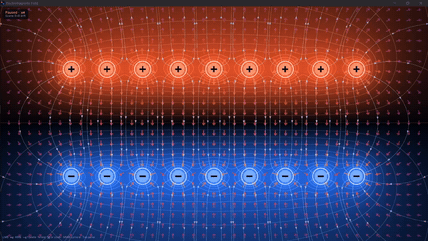
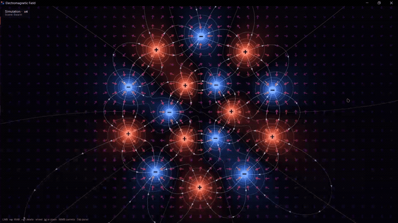
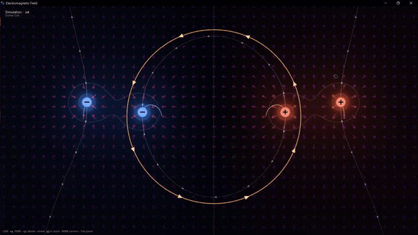
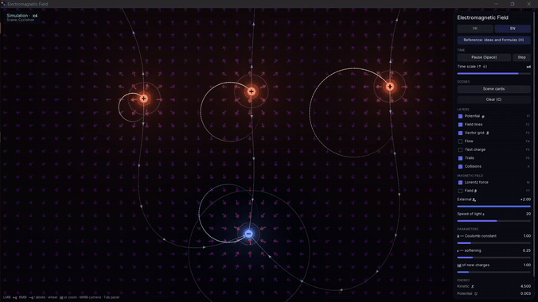

# Electromagnetic Field

Physics sandbox built on the **Wind** engine (built against an installed SDK of
[wismh/wind-engine](https://github.com/wismh/wind-engine), see `wind_project.toml` for the engine version).

## Showcase

<table>
  <tr>
    <td align="center" width="50%">
      <br />
      <b>1 - E×B drift</b>
    </td>
    <td align="center" width="50%">
      <br />
      <b>2 - Swarm</b>
    </td>
  </tr>
  <tr>
    <td align="center" width="50%">
      <br />
      <b>3 - Coil</b>
    </td>
    <td align="center" width="50%">
      <br />
      <b>4 - Handbook</b>
    </td>
  </tr>
</table>

## Build (Windows)

Needs an installed Wind SDK (see "Updating the engine" below). Use the SDK's editor, which configures and builds the
game itself (CMake must be on `PATH`):

```bash
<sdk>/bin/wind_editor.exe --project . --play                 # build and play in the editor
<sdk>/bin/wind_editor.exe --batch --project . --export out/export   # standalone Release build
```

The export holds `electromagnetic-field.exe` with its `assets/`; add `--development` for a build with the profiler.
`out/` is git-ignored. Play builds `DebugGame` (unoptimized game code), which is roughly 80x slower in the field-line
tracer (glm is not inlined), so scenes with moving charges drop to ~15 FPS; use the export for normal use.

Tests (and IDE builds) configure by hand with `CMakeUserPresets.json`:

```bash
cmake --preset editor-local
cmake --build build-editor --target electromagnetic_field_tests --config DebugGame
ctest --test-dir build-editor -C DebugGame --output-on-failure
```

Web (Emscripten) and Android presets (`web`, `android-arm64`) build the engine from the SDK's `source/` directory
(set `WIND_SDK_DIR`); see the engine manual, `docs/manual/platforms`.

## Controls

The right-hand panel mirrors most shortcuts (time, scenes, layers) and adds sliders for the Coulomb constant `k`,
the softening `ε`, the `|q|` of newly placed charges and a signed uniform external `B_z`, plus live energy totals.
Each scene sets the magnetic part itself: scenes 1–7 are electrostatic (Lorentz force off, no external field), 8 and 9 switch the Lorentz force on with their uniform `B_z`, and 0 places a current loop (coil) in the plane whose strongly non-uniform `B_z` makes charges drift around it (grad-B drift). `M` and the panel then toggle it freely. The speed of light `c` (panel slider, default 20) fixes the magnetic constant as `μ₀/4π = k/c²`, so magnetic forces between moving charges are `(v/c)²` of the Coulomb force, as in nature; speeds are capped at `0.9c`, and the panel shows the fastest `v/c`. The readout next to the cursor shows
`|E|`, the components of `E` and the potential `φ`; with the magnetic layer on it also shows `B_z`.

| Input | Action |
|---|---|
| LMB on empty space | add a `+1` charge |
| RMB on empty space | add a `-1` charge |
| LMB drag on a charge | move it |
| RMB on a charge / `Delete` | remove it |
| Wheel over a charge | change `|q|` by 0.25 (0.25 … 5) |
| Wheel elsewhere | zoom about the cursor |
| MMB drag | pan the camera |
| `Home` | reset the camera |
| `F` over a charge | flip the sign |
| `L` over a charge | pin / unpin (pinned charges have a white ring) |
| `Space` | pause / resume |
| `Right` (while paused) | single step |
| `Up` / `Down` | time scale ×2 / ÷2 (1/8 … 8) |
| `1`–`9`, `0` | presets: dipole, like pair, quadrupole, capacitor, orbit, Rutherford scattering, swarm, cyclotron, E×B drift, coil |
| `R` / `C` | reload current preset / clear all |
| `F1`–`F6` | toggle layers: potential, field lines, vector grid, flow tracers, cursor probe, trails |
| `F7` | toggle the magnetic-field marks |
| `M` | toggle the Lorentz force |
| `K` | toggle collisions |
| `Tab` | show / hide the control panel |

## Updating the engine

The game has no engine submodule: it finds an installed Wind SDK. Build and install the SDK from the engine repo
(`cmake --preset vs-editor`, `cmake --build build-editor --config Release`,
`cmake --install build-editor --config Release --prefix out/sdk`), then point the game at it in the git-ignored
`CMakeUserPresets.json`:

```json
{
  "version": 6,
  "configurePresets": [
    { "name": "editor-local", "inherits": "editor",
      "cacheVariables": { "CMAKE_PREFIX_PATH": "C:/path/to/sdk" } }
  ]
}
```

To update the engine, install the new SDK (Wind Launcher's SDKs page), set `engine` in `wind_project.toml` to its exact
version (currently `0.1.5a`) and the tag of `setup-wind` in `.github/workflows/ci.yml` to `v<version>`, and point
`CMakeUserPresets.json` at it. CI (Windows, Linux and macOS) downloads the SDK of that version, runs the tests, and exports the game.
